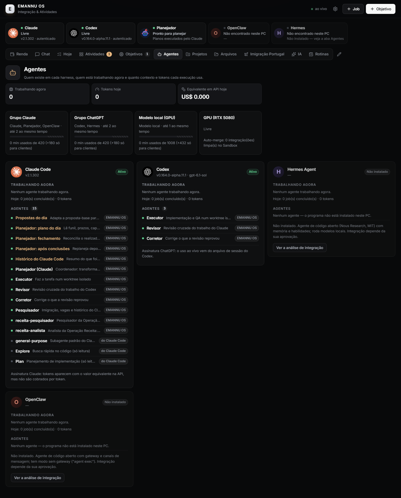
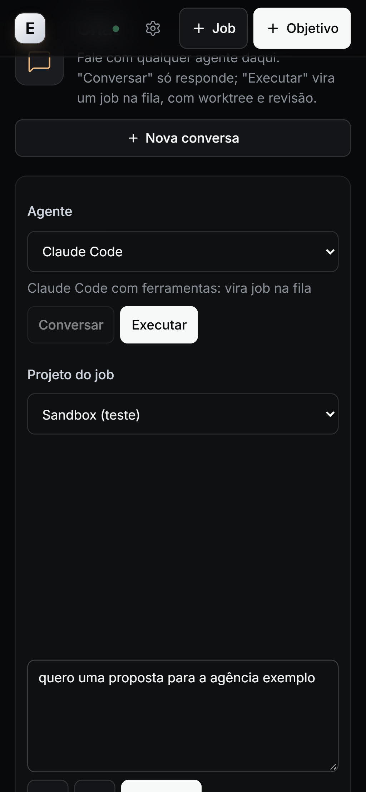
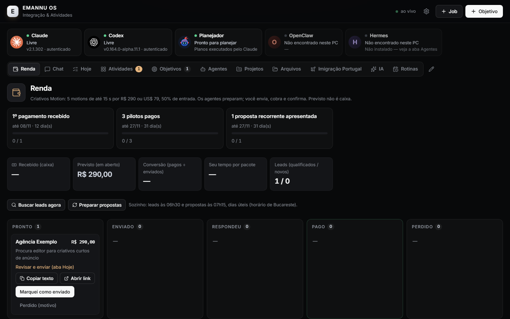
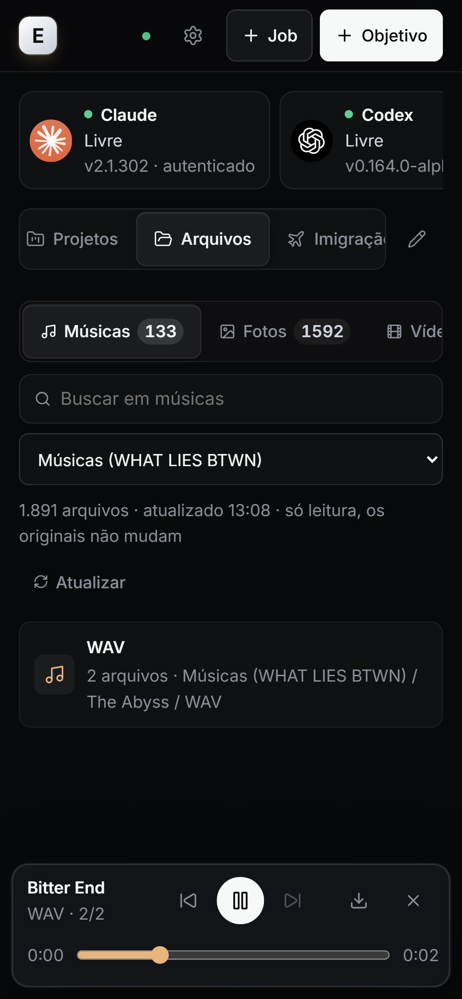

# EMANNU OS

**A personal operating system for running AI coding agents safely — from my phone.**

EMANNU OS is a self-hosted control panel that turns a single Windows PC into a small "AI team": it queues work for **Claude Code**, **OpenAI Codex**, **Hermes** and **OpenClaw**, runs code jobs in isolated git worktrees, makes the agents **review each other's work**, and only lets changes reach `main` after review and tests pass — auto-merge applies only to projects that earned it (a sandbox first, then a track record of clean integrations); everything else waits for my approval. I use it every day from my phone through a private Tailscale network.

> Built by Emannuel Serrão. The UI is in Portuguese (my daily language); code, tests and architecture notes are open to read. Personal data (family, finances, documents) was removed from this public copy.

<p align="center">
  
  
</p>

## What it does

| Area | Highlights |
|---|---|
| **Job queue for AI agents** | Claude Code, Codex, Hermes and OpenClaw run as child processes with per-agent concurrency limits, timeouts (up to 120 min with 15-min progress checkpoints), usage-limit detection that pauses the whole provider group, and crash recovery that kills orphaned process trees on restart. |
| **Isolation & cross-review** | Code jobs on git projects run in their own git worktree (review and fix-up jobs reuse it; research and planning jobs run without one). Claude's work is reviewed by Codex and vice-versa; a structured JSON verdict decides between merge, fix-up job or human decision. Auto-merge is bound to the exact base/head/diff hash, runs tests in a candidate worktree and promotes with fast-forward only, with automatic revert on regression. |
| **Governance tiers** | Every action is classified GREEN / YELLOW / RED. RED (sending messages, payments, publishing, credentials, deleting outside the project) is never done by an agent. Human confirmations require a registered device plus an on-screen confirmation; the admin token is refused on purpose. |
| **Planner loop** | A Claude-based planner turns objectives into plans with budgets (max descendants, depth, minutes), deduplicates its own runs and escalates anything risky to the human. |
| **Routines engine** | One cron scheduler (with time-zone and DST handling, catch-up windows and claim/fence semantics on SQLite) drives research, lead scoring, proposals, summaries and weekly maintenance. |
| **Chat tab** | One box to talk to Claude, Claude Code, Codex, GPT (Hermes) or a "Council" (two models answering independently, then a synthesis). *Converse* mode is read-only and resumes each agent's own session; *Execute* mode becomes a governed job. Live streaming over SSE, voice input on mobile, attachments. |
| **Files tab** | Read-only media library over the PC's folders: music player that keeps playing across tabs (with lock-screen controls), photo albums with ffmpeg thumbnails, video and document viewer, downloads. Paths are confined to their roots (no `..`, junction or symlink escapes) and secret files are never listed or served. |
| **Game mode & GPU lock** | Detects when I'm gaming and defers GPU-heavy jobs; local models (LM Studio) share a GPU lock with priority for client work. |
| **Mobile PWA** | Installable app with PIN + per-device tokens, Web Push notifications, offline snapshot, 44px touch targets and no horizontal scroll (checked by tests). |
| **Obsidian integration** | Reads project notes from my vault, appends dated blocks and refreshes only its own marker-delimited sections — it never rewrites text written by hand. |

<p align="center">
  
  
</p>

## Stack

- **Server:** Node.js 24 running TypeScript directly, Fastify 5, built-in `node:sqlite`, Server-Sent Events, Web Push.
- **Web:** React 19 + Vite 7 PWA, custom service worker, View Transitions.
- **Agents:** Claude Code CLI, Codex CLI, Hermes Agent, OpenClaw (all through my own subscriptions — no paid API keys), LM Studio for local models.
- **Tests:** 226 Vitest tests (server, scheduler, governance, security) and 13 Playwright end-to-end tests on an emulated Android phone and a 1440px desktop.
- **Infra:** Windows Task Scheduler autostart, Tailscale Serve (tailnet-only HTTPS), git worktrees.

## How I build it

Most of the code is written by AI agents under my direction, and the system itself is the process I use to do that safely:

1. I write the spec (in Portuguese) and split it into sprints.
2. Claude Code implements each sprint on its own branch, with tests.
3. **Codex reviews every branch through the system's own queue** in read-only mode and returns a JSON verdict. Reviews repeat until it passes — the review rounds caught real bugs, such as a path-confinement bypass and a race condition in the Slack bridge, and each fix got a regression test.
4. I test on my phone and approve the merge.

## Project layout

```
apps/server/src   Fastify API, scheduler, routines, runners, governance, modules
apps/server/test  Vitest suites (incl. fake agent processes)
apps/web/src      React PWA
packages/shared   Types shared by server and web
e2e/              Playwright tests (phone + desktop)
docs/             Architecture notes, guides (Portuguese), screenshots
```

## Running it

```bash
npm install
npm test            # server tests
npm run test:e2e    # builds the web app and runs Playwright
npm start           # http://127.0.0.1:8850 — set the PIN on the PC on first run
```

The paths in `apps/server/src/config.ts` point to my folders; every one of them can be overridden with an `EMANNU_*` environment variable. The system expects the agent CLIs to be installed and logged in; anything missing shows up as "not installed" in the Agents tab.

## License

Source available for reading and evaluation. All rights reserved.
